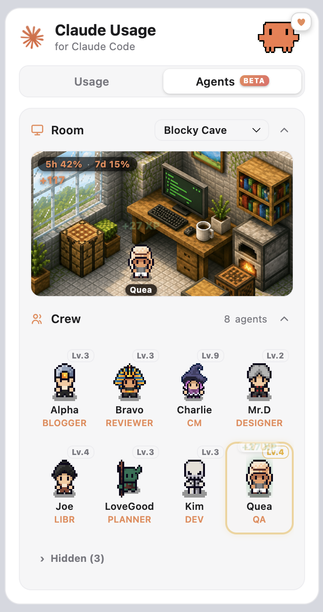
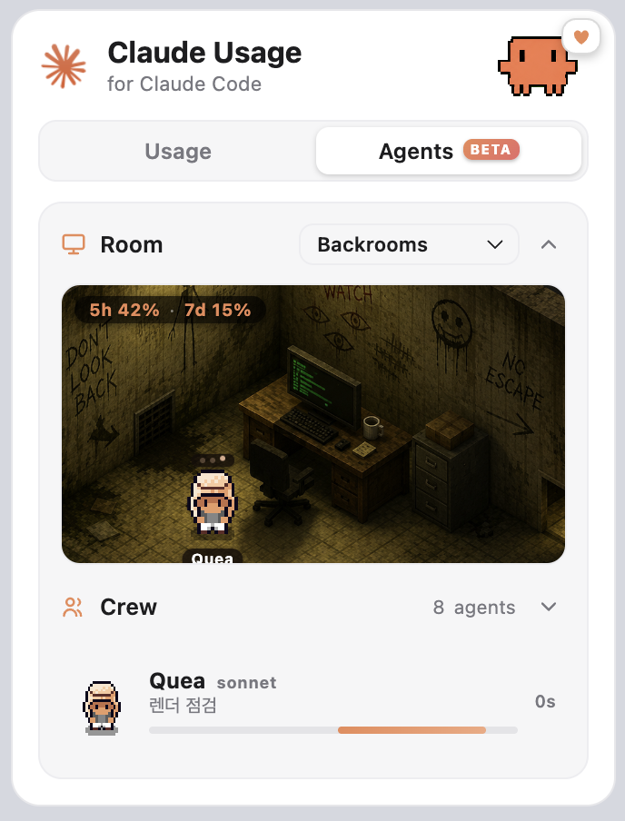
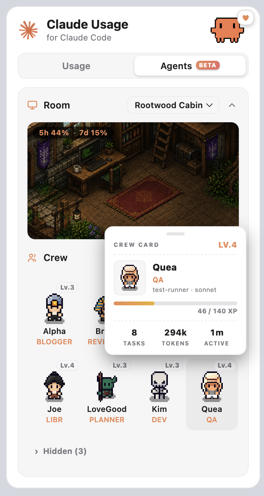
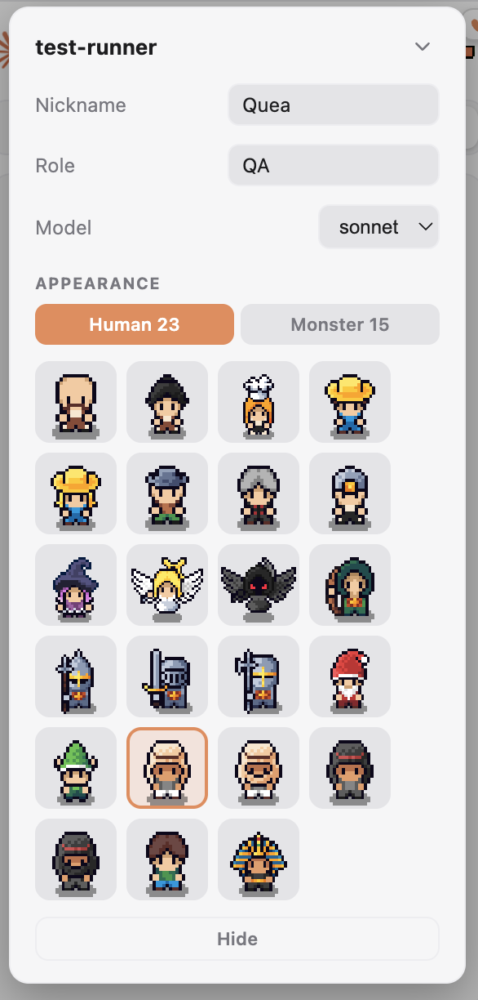
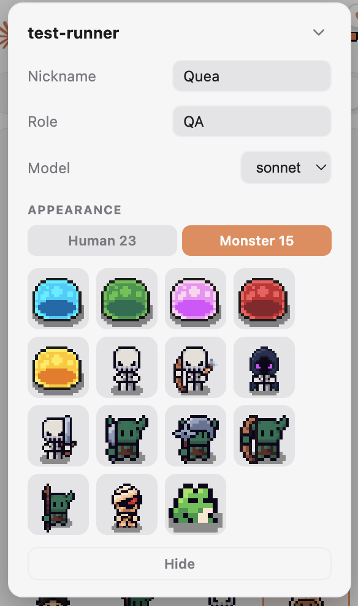
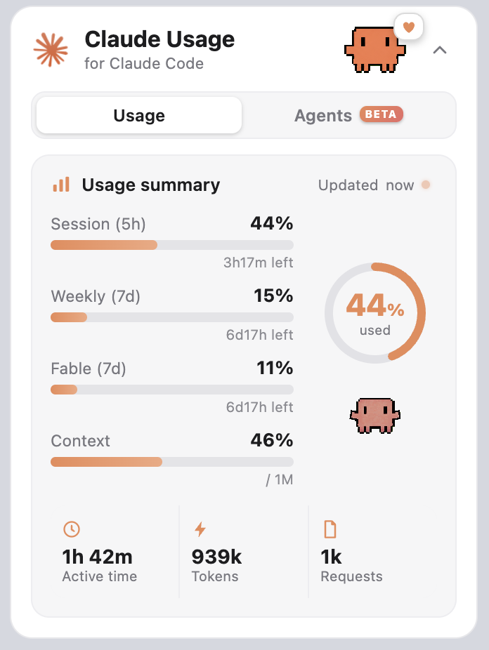
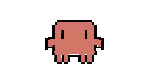
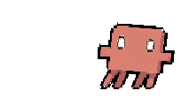
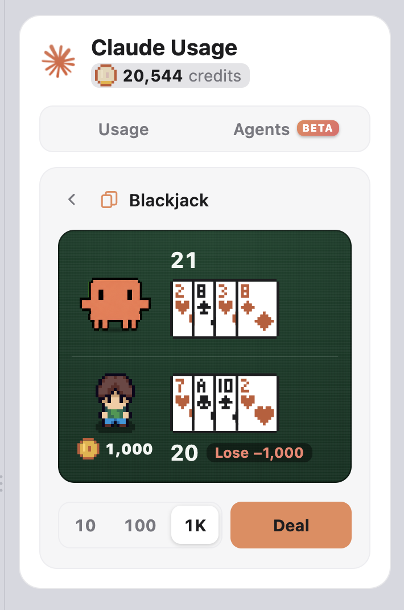

# Claude Usage Crab

  

**See which Claude Code subagents are running, right now, without leaving VS Code.** Every agent in `.claude/agents/` becomes a distinct pixel character. When one is actually invoked it walks into the Room, sits at the desk and gets to work. Live session, weekly and context usage sit in the same panel and in the status bar.

Read-only, hook-free, local. Nothing to configure.

> Unofficial community extension. Not affiliated with Anthropic.

## Agents

A background subagent is a black box. You fire one off and then wonder whether it is working, finished, or wedged. This tab answers that at a glance.

  
  &nbsp;&nbsp;
  

Agents walk in when invoked and type at the desk while they work. Fold the Crew and it becomes a compact "now running" strip with the task and elapsed time. Pick from twelve rooms in a thumbnail grid.

- **Who is running**, as a character in the room, not a log line you have to go looking for. Parallel calls of the same agent stand side by side as separate characters.
- **What it cost.** The harness stamps each finished subagent's tokens, tool calls and duration into the transcript, and the panel reads them back. "Which agent eats my weekly limit" is a fact here, not a guess.
- **Stuck?** An agent running far past its own usual duration is flagged amber instead of quietly vanishing, so a wedged background agent is something you notice.
- **Levels that mean something.** Finishing work earns XP, so an agent's level is a readout of how much it has actually done for you. Your history is swept once on first run, so nobody starts at Lv.1 with a year of work behind them.

  

Hover a character for its crew card: level and XP progress, plus the lifetime tasks, tokens and active time that earned it.

  
  &nbsp;&nbsp;
  

Give an agent a nickname and a role, pick its character from 38 sprites, or change its model. The model change is written straight to the agent's <code>.claude/agents/*.md</code>. Agents you never want to see can be hidden, and brought back from the Hidden row.

Detection is **transcript-based and read-only**. It never blocks or changes how your agents run, and it needs no hooks or setup. Claude Code's own built-in agents (Explore, Plan, general-purpose) show up too, labelled as such, so a character you never created is never a surprise.

Because a background subagent has no knowable progress, running agents show an indeterminate bar and elapsed time, not a fabricated percentage.

## Usage panel

  

  
  &nbsp;&nbsp;
  
  &nbsp;&nbsp;
  
  &nbsp;&nbsp;
  

The crab reads your session usage: calm under 50%, heads-down at 50%, unravelling past 70%, flat-out near the limit.

## Credits and games

  

The tokens you spend earn credits: one per 100K, weighted the way the API prices them, so output counts five times an input token and a cache read a tenth. On first run your past sessions are counted once in the background, so you start with what you have already earned. The balance sits under the title, next to a coin that fills toward the next credit.

Click it for the games list, where the crab runs fourteen games in four families. Star the ones you come back to and they move to the top; each family folds away.

**Card tables.** **Blackjack**: six decks, the dealer stands on soft 17, blackjack pays 3:2, double on your first two cards, split once. **Red Dog**: two cards are dealt apart and the bet is whether the third falls between them. **High-Low**: one card lies face up and you call whether the next one beats it, with each side priced off the cards actually left in the shoe, so the odds move as the run goes on. **Draw Poker**: jacks or better, 8/5, one draw, and the row you were paid for lights up.

**Machines.** **Slots**: three rings of 24, rolled to the position the extension picked, so the reel you watch is the reel that paid. **Plinko**: twelve rows, thirteen cups, three risk tables, and the bead speeds up as it falls. **Wheel**: every slice carries its own multiplier, written on it. The wide ones pay nothing and the thin one pays twelve. **Scratch Card**: a 3x3 card you rub one square at a time, and nothing is claimed until all nine are open.

**Dice.** **Roll Under**: drag a line anywhere from 1 to 96 and roll under it. The side that wins is the side that is filled in, and the roll lands on the same ruler you set the line with. **Sic Bo**: three dice and one bet, small, big, any triple, or an exact total; the cell the dice actually landed in lights up, so a loss says why it lost. **Hazard**: roll as often as you dare. Every pip drops into the tray and a 1 empties it. **Shut the Box**: nine tiles and two dice, close any set that adds up to the roll. The tiles you cannot use this throw cannot be pressed, so there is nothing to add up.

**What you keep.** **Sword Forge**: the crab is a blacksmith here. Pay a fee and the sword goes up a level, or stays, or drops back, and from the level its blade starts to glow it can break and take the whole thing with it. A failed strike heats the forge and the next attempt is better for it, but the danger itself never moves. The price the sword fetches is on the Sell button before you press anything, so stopping is always a choice you can price. **Coin Market**: four coins on a three-hour candle chart. Buy with credits, sell whenever you like, 0.5% on the round trip, and the position is still there when you come back. The fee is small because the holding is long: a coin moves about 1% to 2.5% in a day, so coming back tomorrow is worth more than closing costs, while a minute of it is never worth the trip.

Nothing you do moves a coin's price. The chart is the same in every window and on every install, it is drawn from the minute it belongs to, and there is no way to buy into a rise you have already seen. Every game with a pay table returns between 96% and 97%, and no single rung, cup, segment or stopping rule beats another; each table was solved by counting every outcome rather than sampled. The market has no table and no round, so there is nothing to return a percentage of: what is proved about it instead is that no rule for deciding when to sell is worth more than any other, and the round trip costs 0.5%.

The extension deals and judges, so a hand survives switching tabs; reloading the window voids it. The sword and your coin positions are what is kept. Credits are earned by using Claude Code and nothing else. They cannot be bought, and they cash out to nothing.

## Features

- **Agents.** Your subagents as distinct pixel characters that walk into a room when invoked, with levels, lifetime stats and per-agent nickname, role, character and model. Read-only, hook-free.
- **Credits and games.** Your token spend becomes credits, and the crab runs fourteen games for them: four card tables, four machines, four dice games, a sword forge and a coin market. Hide the whole thing from the settings gear if you would rather not have it.
- **Session (5h) / Weekly (7d) / Fable (7d).** The same live numbers as Claude Code's built-in usage dialog.
- **Context window.** How full the current conversation is, scoped to the workspace you are actually in, with the window tier detected per session.
- **Today's tokens and requests.** Summed across your local Claude Code sessions, with a `+N k` delta after each response. Resets at local midnight.
- **Status bar.** A compact `5h 54% · wk 46%`, turning red as you approach the limit.
- **Burn-rate warning.** A heads-up when one recent request's token spend spikes well past today's average.
- **Fold what you don't need.** Room and Crew each collapse from their own header and remember the choice, so the panel takes only the space you want to give it.

## How it works and privacy

Everything is read locally from your `~/.claude` folder. No telemetry, no third party, and no server of ours unless you agree to share with your account's other PCs (below).

- **Agents, tokens, requests, context** are parsed from your local session transcripts (`~/.claude/projects/**/*.jsonl`), incrementally, so a long day of transcripts does not mean re-reading them every tick.
- **Session, weekly and Fable limits** come from *listening* rather than polling. When the Claude Code extension checks its own usage in the same host process, this extension observes that response through Node's `diagnostics_channel` and reuses it. That means **zero extra API requests** in normal use, and numbers that match the built-in dialog exactly because they *are* the built-in dialog's numbers.
- **Fallback.** If that tap has been quiet for a while, the extension calls Anthropic's usage endpoint (`https://api.anthropic.com/api/oauth/usage`) itself, using your own signed-in token, or Claude Code's stored OAuth token if you have not signed in.

Your token is sent **only** to `api.anthropic.com` and nowhere else. The code is open, and it is plain JavaScript with no build step, so what ships in the `.vsix` is what is in the repo.

**Sharing with the same account's PCs (off until you agree).** For people who share one Claude account. Once, the extension asks whether to share; say yes (or choose Share under Weekly > Details, or set `claudeUsage.team.share`) and every PC signed in to the same Claude account that also agreed shows up side by side, adding up to the account's weekly %. No code to type: the group is the account, identified only by a hash of its id, so only PCs signed in to it can read it. While sharing is on, every 5 minutes this PC sends the extension author's server (`saegimai.up.railway.app`): your display name, the weekly window, the account's weekly %, the plan type (Max 20x, Max 5x or Pro), and this PC's use in that window (tokens and an API-price equivalent, per model). The server also keeps one snapshot of these per PC per hour, so the estimate can be checked over a week. Never prompts, file or project names, session titles or any token. A PC that does not agree sends nothing, and the question is not asked where VS Code telemetry is off. Stop sharing under Weekly > Details.

The usage endpoint and the transcript format are both undocumented and may change. If they do, the affected numbers may stop updating until the extension is updated.

## Getting started

Install, then open the **Explorer** sidebar. The **Claude Usage** panel appears alongside your files with **Usage** and **Agents** tabs. The status bar item shows a compact summary and opens the panel on click.

Don't want it on the left? Drag the **Claude Usage** view header into the secondary side bar on the right, or down into the bottom panel next to the Terminal. VS Code remembers where you put it.

Agents appear automatically for any `.claude/agents/*.md` in the workspace or in `~/.claude/agents/`. No hooks, no config.

## Requirements

- Claude Code (CLI or VS Code extension) signed in with a Claude account.
- macOS, Linux or Windows. Data is read from `~/.claude`.

## License

The extension source is MIT. See [LICENSE](LICENSE).

The bundled pixel art is **not** covered by the MIT licence. It is licensed third-party artwork included here for use within this extension only, and is not offered for reuse or redistribution. See the third-party notice in [LICENSE](LICENSE).
